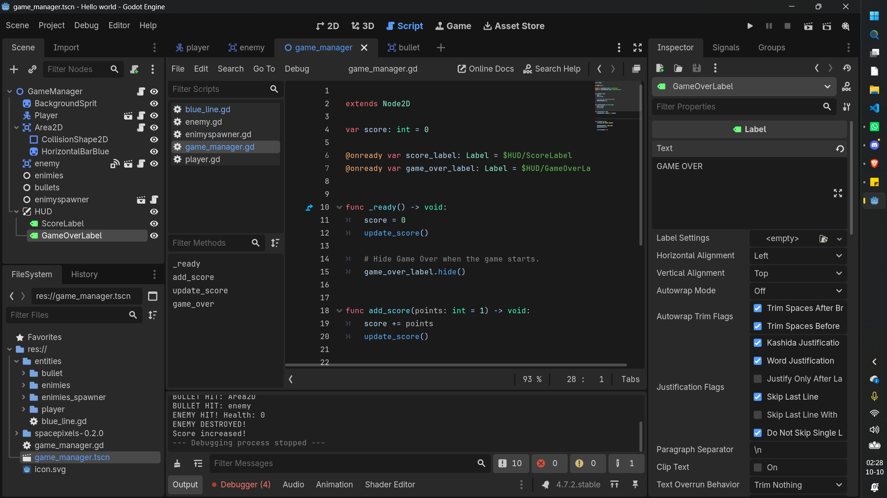

# Rocket Space Launcher

Rocket Space Launcher is a fast-paced arcade space shooter built in Godot 4. You control a small rocket ship, fire at incoming enemies, and survive as long as possible while protecting the blue defense line.

## About the Game

In this game, the player moves left and right across the screen and shoots incoming enemy ships before they reach the danger zone. Every enemy destroyed adds to your score, and the round ends when an enemy slips past your defense line.

The game uses a simple retro space style, quick controls, and exciting survival gameplay that makes each run feel intense and replayable.

## Gameplay Preview

### Screenshots

### Gameplay Video

<video controls width="100%">
  <source src="assets/Screen%20Recording%202026-10-10%20022947.mp4" type="video/mp4">
  Your browser does not support the video tag.
</video>

## How to Play

- Move left: A / Left Arrow
- Move right: D / Right Arrow
- Shoot: Space

## Objective

- Destroy incoming enemies
- Prevent them from crossing the blue line
- Increase your score
- Survive as long as possible

## Run the Game

1. Open the project in Godot 4.
2. Load the project folder.
3. Press F5 or click Run to start the game.

## Project Details

- Engine: Godot 4
- Language: GDScript
- Genre: Arcade shooter / survival
- Style: Retro pixel-inspired space game

## Notes

Rocket Space Launcher is a simple but fun mini-game project designed to showcase quick arcade action and responsive controls.
